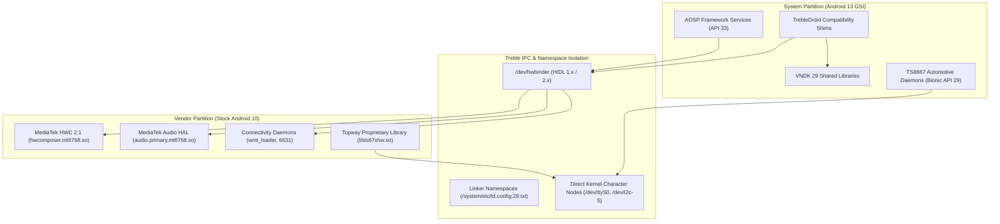

# Chapter 19: Android 13 Treble, VINTF & VNDK 29 Compatibility Analysis for TS8667

**Target Platform:** Junsun V1 Plus / Topway TS8667 (`spm8667p1_64`, MT6768 / MT8667)  
**Vendor Baseline:** Stock Topway Android 10 (`ro.vendor.build.version.release=10`, API level 29, VNDK 29)  
**System Target:** Generic System Image (GSI) Android 13.0 (TrebleDroid / Phh v13.0 ARM64 A/B)  
**Kernel:** Linux 4.14.186 (`aarch64`, MTK modified kernel)  
**Auditing Standard:** Rigorous architectural decomposition of system-vendor interfaces, VINTF matrices, and known Treble gap areas.

---

## 1. Treble Architectural Separation

Under Project Treble architecture (enforced since Android 8.0, hardened in Android 10):
- The physical device partition layout separates the generic framework (`system`) from SoC/board-specific implementations (`vendor`).
- Communication between the Android 13 System partition and the Android 10 Vendor partition occurs strictly across standardized IPC boundaries:
  1. **HIDL HALs:** Hardware Interface Definition Language over `/dev/binder` and `/dev/hwbinder`.
  2. **VNDK (Vendor Native Development Kit):** Versioned dynamic libraries (`vndk-29`) isolating system and vendor namespaces.
  3. **VINTF (Vendor Interface Object):** Schema-based compatibility verification matching system expectations against vendor declarations.



---

## 2. Subsystem Compatibility Matrix & VINTF Assessment

| Subsystem | Stock Android 10 Vendor Implementation | Android 13 GSI Expectation | TrebleDroid Bridge Mechanism | Compatibility Risk | Mitigation & Fallback |
|:---|:---|:---|:---|:---:|:---|
| **Graphics & Display** | `android.hardware.graphics.composer@2.1-service` (HIDL) | AIDL Composer or HIDL 2.1-2.4 | TrebleDroid maintains backward compatibility for HIDL Composer 2.1. | Low | Forced landscape properties (`ro.sf.hwrotation=0`, `debug.sf.latch_unsignaled=1`). |
| **Audio Primary** | `android.hardware.audio@5.0` / MTK Primary HAL | AIDL Audio or HIDL 6.0/7.0 | Audio HAL wrapper in TrebleDroid supports HIDL 5.0. | Medium | Hardware unmuting handled directly by `bd3702_init` daemon on `/dev/i2c-5`. |
| **Wi-Fi & Bluetooth** | MTK MT6631 combo chip via SDIO & `wmt_loader` | `android.hardware.wifi@1.3`, `bluetooth@1.0` | Relies on vendor `/vendor/bin/wmt_loader` started by init. | Low-Medium | TrebleDroid includes standard MTK connectivity shims. |
| **RIL / Cellular** | MediaTek telephony daemons (`ccci_fsd`, `ccci_mdinit`) | `android.hardware.radio@1.4` | TrebleDroid supports MTK CCCI IPC shims. | Low | Standard LTE data SIM works out-of-the-box on TrebleDroid MT6768. |
| **Thermal Protection** | MTK Thermal Framework (`mtk_cooler`, `thermal_zone0`) | Standard sysfs thermal query | Direct read of `/sys/class/thermal/thermal_zone0/temp`. | None | Passive chassis heatsink cooling verified; daemon operates in monitor mode. |
| **Camera (Techpoint TP2850)** | Proprietary AHD decoder via `AVM2.apk` + `libts67xhw.so` | Standard Camera2 / AIDL Camera | **NO AOSP HAL EXISTS**. AHD 360/reverse feed requires vendor companion app. | **High** | Isolate `AVM2.apk` and `libts67xhw.so` as standalone automotive companion app. |
| **FM Tuner (TDA7708)** | Proprietary I2C radio via `Radio.apk` + `libts67xhw.so` | Broadcast Radio HAL 2.0 | **NO AOSP HAL EXISTS**. TDA7708 has no Broadcast Radio HAL implementation. | **High** | Bundle vendor `Radio.apk` companion app with custom automotive UI skin. |

---

## 3. VNDK 29 Dependency Analysis

Stock vendor binaries link against Android 10 VNDK libraries (`VNDK-SP 29` and `VNDK-core 29`):
1. `libcutils.so` (version 29)
2. `libutils.so` (version 29)
3. `libhidlbase.so` (version 29)
4. `libbinder.so` (version 29)

### Verification in TrebleDroid GSI:
TrebleDroid v13.0 incorporates:
- Apex package `/system/system_ext/apex/com.android.vndk.v29` containing bit-compatible prebuilts of all VNDK 29 libraries.
- The dynamic dynamic linker configuration (`/system/etc/ld.config.29.txt`) automatically maps vendor process requests from `/vendor/bin/*` to the versioned VNDK 29 namespace, preventing symbol resolution mismatches against Android 13's native libraries.

---

## 4. Empirical Boot Testing Plan (RAM-First Verification)

Prior to any ROM installation:
1. **Stage 1 (TWRP RAM Boot):** Execute `fastboot boot twrp_junsun_37.img`. Confirm Goodix touchscreen input, 1280x720 panel rendering, and ADB connectivity.
2. **Stage 2 (VINTF Extraction):** While running in TWRP RAM, dump physical vendor VINTF manifest:
   ```bash
   adb shell "cat /vendor/etc/vintf/manifest.xml" > physical_vendor_manifest.xml
   ```
3. **Stage 3 (Read-Only Compatibility Check):** Compare `physical_vendor_manifest.xml` against AOSP 13's `framework_compatibility_matrix.xml` before authorising any partition write.
